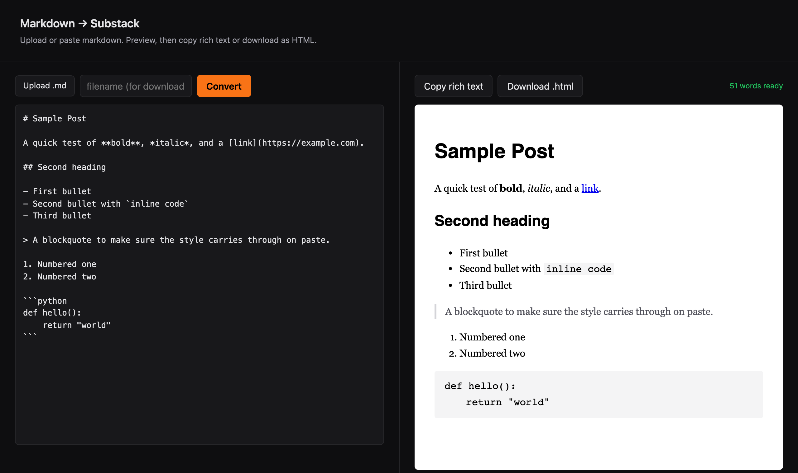

# Markdown to Substack

Write your post in Markdown, then paste it into Substack with the formatting intact:
headings, bold, italics, links, lists, quotes and code.

Substack's editor doesn't accept Markdown, so pasting a `.md` file gives you raw
asterisks and hashes. This turns it into rich text first.



## Setup

You need Python 3.9+.

```bash
git clone https://github.com/nimishas81/md-to-substack.git
cd md-to-substack
pip install -r requirements.txt
```

## Use it from the command line (macOS)

```bash
python3 convert.py post.md
```

This copies the post to your clipboard as rich text. Open a Substack draft and paste
it with Cmd+V. Add `--print` to also print the HTML.

## Use it in the browser (any OS)

```bash
python3 app.py
```

Open http://localhost:5051, paste or upload your Markdown, check the preview, then
click **Copy rich text** and paste into Substack. You can also download the result as an
`.html` file.

## What carries over

- Headings, bold, italics, links, bullet and numbered lists, blockquotes
- Smart quotes and dashes
- Code blocks paste as plain preformatted text, without syntax highlighting

**Tables:** Substack's editor doesn't support tables, so a pasted table loses its
layout and may lose its links. Turn tables into lists before converting.

Images aren't uploaded. Add them in Substack after pasting.

## Known issue

Links can go missing when pasting into Substack, even though the converted text
contains them. The cause isn't confirmed yet. If it happens to you, please open an
issue and say which browser you use.

## License

MIT
